# WiPulse

WiPulse - Contactless Vital Sign Extraction

1. [Setup](/setup/README.md)
1. [Extraction App](/echo/README.md)

- Current Problems

1. [Current Problems](/plans/current_problems.md)

- Old Plans

1. [HR Pipeline plan](/plans/old/plan.md)
1. [another Pipeline plan](/plans/old/another_plan.md)
1. [rough Pipeline plan](/plans/old/rough.md)

## Contents

1. [Brief](#brief)
1. [Goals](#goals)
1. [Drawing](#drawing)
1. [Progress](#progress)
1. [Learming thus far](#learning-thus-far)
    1. [OSI Model](#osi-model)
    1. [Hardware](#hardware)
    1. [Frames](#frames)
    1. [Channels](#channels)
        1. [Why 80 MHz](#what-does-80-mhz-actually-give-you)
        1. [Summary](#summary)
    1. [Channel Information](#channel-information)
        1. [channels in ZA](#possible-5g-channels-in-za-south-africa)
    1. [Filters](#filters)

## Brief

Contact-based vital-sign extraction, while reliable, is uncomfortable, non
portable, and impractical in many situations — particularly for infants and 
elderly individuals. This project proposes WiPulse, a contactless vital-sign 
extraction system that uses Wi-Fi Channel State Information (CSI) to 
monitor heart rate without physical contact. Rather than relying on 
hardware that is difficult to source, such as the Intel 5300 NIC, the system 
uses an ESP32 — a low-cost, readily available IoT device — to extract CSI 
amplitude data. A Raspberry Pi 5 serves as the processing platform, where 
Fourier transforms and Fourier series are applied to convert the extracted 
signals from the time domain to the frequency domain, and noise is filtered 
from the resulting data. A Long Short-Term Memory (LSTM) machine 
learning model is then trained using ground-truth heart-rate readings 
obtained from a PPG optical sensor and smartwatch. The processed output 
is displayed on a screen and delivered through a web API for mobile 
monitoring. This project demonstrates that contactless vital-sign extraction 
is achievable using minimal, affordable, and commercially available 
consumer hardware, offering a less intrusive alternative for monitoring 
vulnerable individuals. 

## Goals

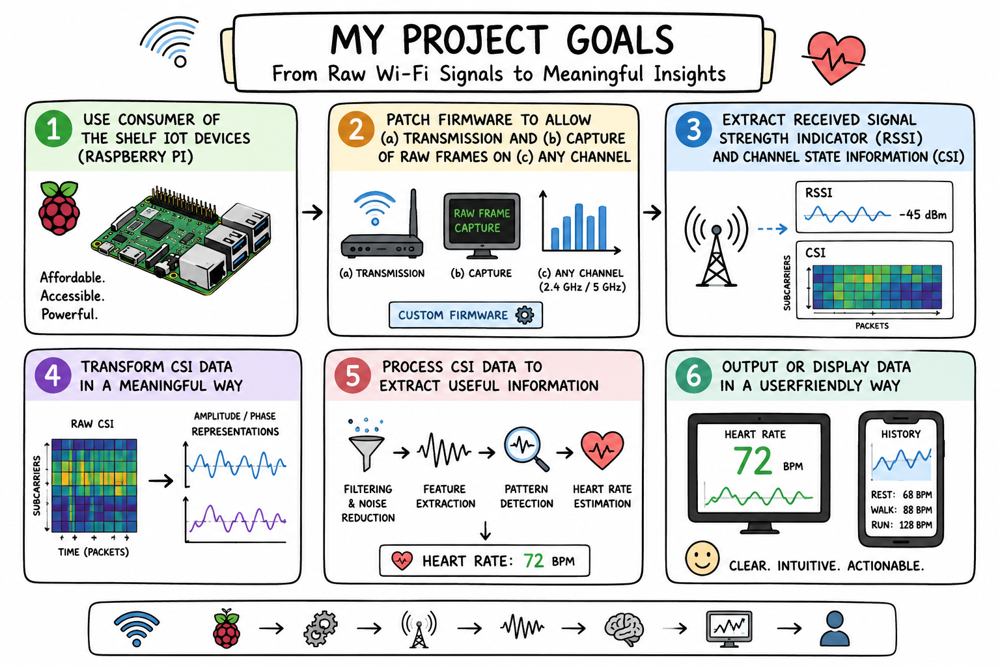

1. Use consumer of the shevle IOT devices
2. Patch firmware to allow (a) transmission and (b) capture  of raw frames on (c) any channel
3. Extract Received Signal Strength Indicator (RSSI) and  Channel State Information (CSI)
4. Transform CSI data in a meaningful way
5. Process CSI data to extract usefull information
6. Output or display data in a userfriendly way

## Drawing

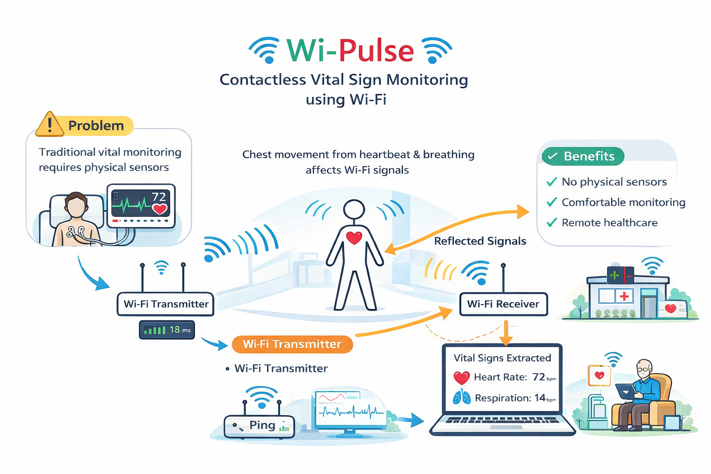

## Progress

Progress thus far:

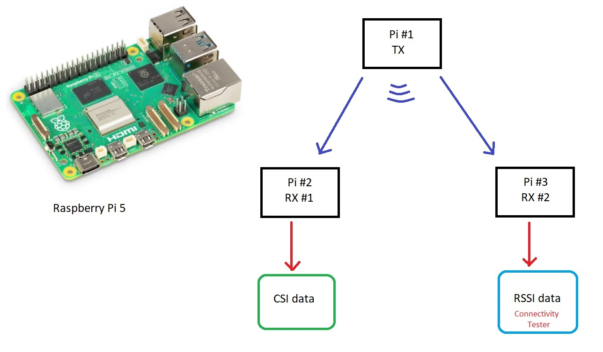

- Setup

1. [Setup](/setup/README.md)
1. [Extraction App](/app/README.md)

- Notes

1. [TX](/notes/tx/README.md)
1. [RX](/notes/rx/README.md)
1. [Extraction](/notes/extraction.md)
1. [channels](/notes/channels.md)

## Learning Thus Far

### OSI Model
Looking at the OSI model, working only with Application and media layers. Use and App to create frames.

### Hardware
How the OS uses drivers to interface firmware that use hardware
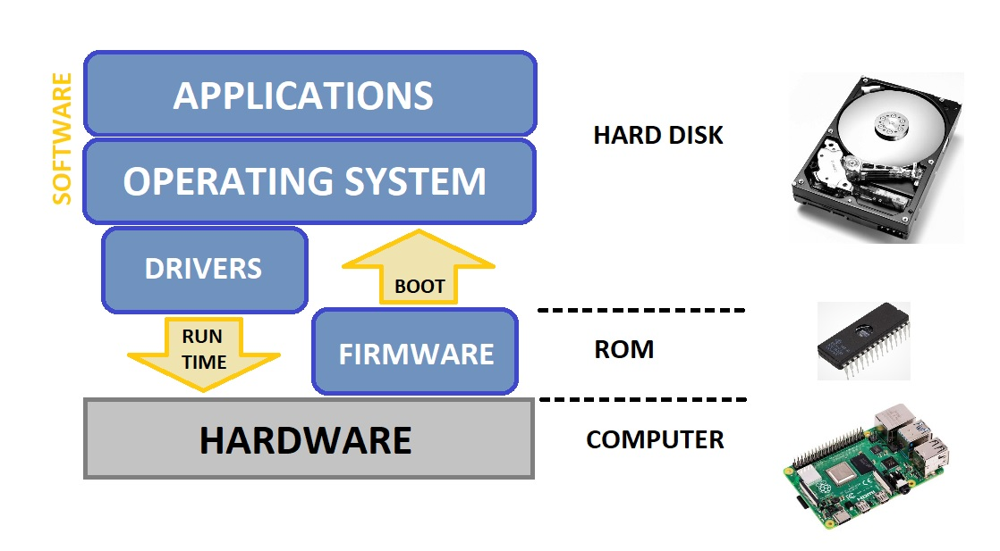
Details
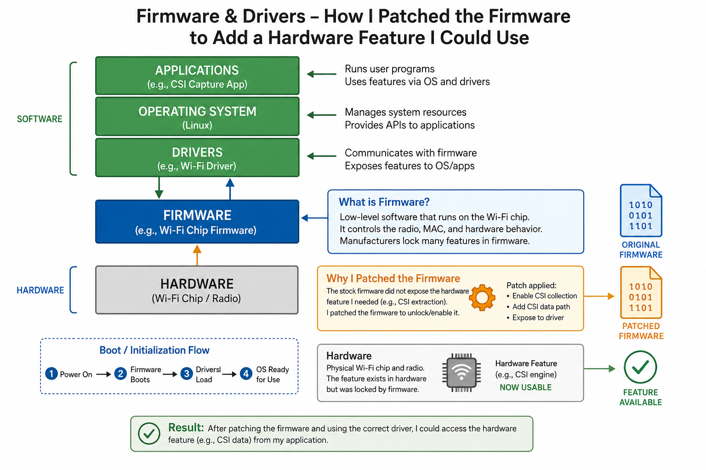

- Why i pathch firmware and drivers
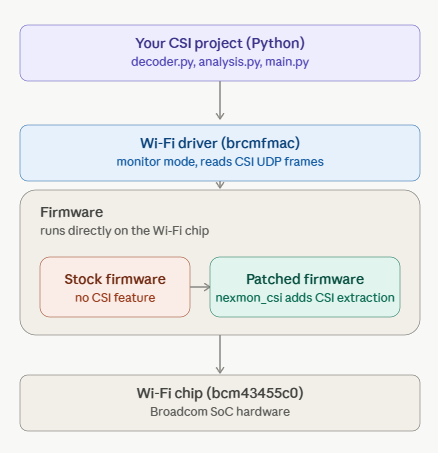

- Result
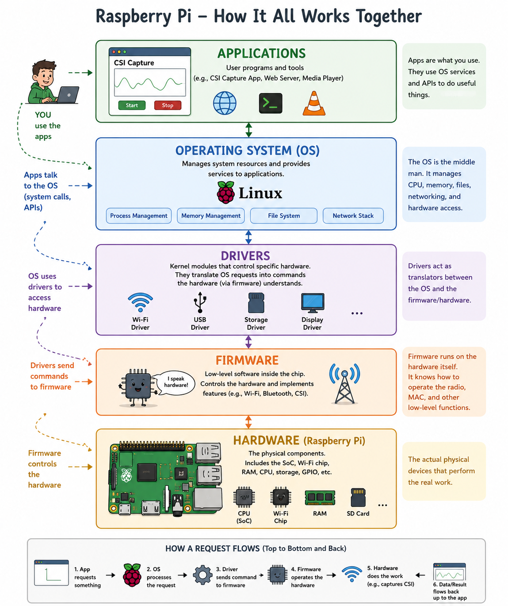

### Frames

How my frames are created
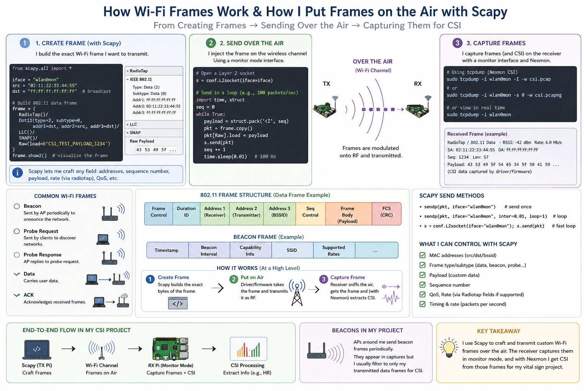

How my frames are placed on the air
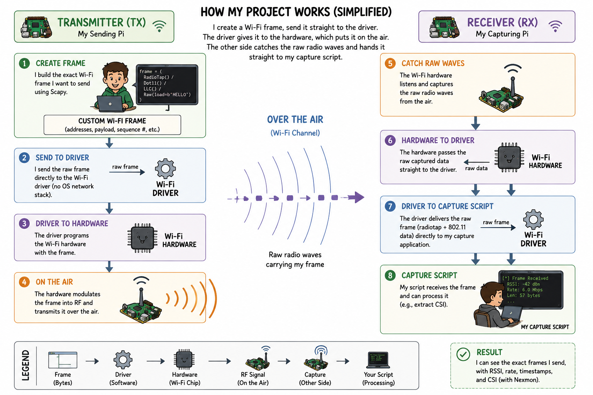

### Channels

For 5 GHz Wi-Fi, if you configure:

Primary channel: 36
Channel width: VHT80 (80 MHz)

then you are using 4 contiguous 20 MHz channels:

**Channel 36 (5180 MHz)**

**Channel 40 (5200 MHz)**

**Channel 44 (5220 MHz)**

**Channel 48 (5240 MHz)**

How many channels are you using?

4 x 20 MHz channels combined into one 80 MHz channel.

What is the center frequency?

The center frequency is halfway across the 80 MHz block:

5180 MHz + 30 MHz = 5210 MHz 

So the center frequency is 5210 MHz.

#### What does 80 MHz actually give you?

Think of bandwidth like this:

| Bandwidth | Approx. useful OFDM subcarriers | CSI size |
|--|:--:|--|
|20 MHz| ~64 |	Small|
|40 MHz| ~128 |	Medium|
|80 MHz| ~256 |	Large|

#### Summary

| Setting |	Value |
|--|--|
| Primary channel |	36 |
| Width |	VHT80 (80 MHz) |
| 20 MHz channels used |	36, 40, 44, 48 |
| Frequency range |	5180 MHz to 5260 MHz |
| Center frequency |	5210 MHz |

In 802.11ac/ax terminology, this is the 80 MHz channel block centered at 5210 MHz (often referred to as the channel group 36-48).

### Channel Information

#### Possible 5G channels in ZA (South Africa)
| Setting | Info |
|--|--|
| 80MHZ | 36 , 44  , 100 , 108 , 116 , 124 |
| 20MHz | 40 , 48 , 104 , 112 , 120 , 128 , 136 |
| HT20 | 20 MHz channel. Typical PHY rate: up to ~72–150 Mbps per stream. |
| HT40+ | Uses 40 MHz by bonding two adjacent 20 MHz channels. |
||       // Primary channel is the lower one. Secondary channel is above (+).|
|HT40- | Primary channel is the upper one. Secondary channel is below (-). |
| Example||
| HT40- | usually means channels 36+40. |
| HT40+ | usually means channels 40+44. |
| VHT80  | Uses 80 MHz total width. Bonds four 20 MHz channels.|
|| Requires 802.11ac support.|
| 80 MHz | These are often used interchangeably.|
| Example ||
| 80 MHz | channel width.|
| VHT80 | 802.11ac mode using an 80 MHz width.|

### Filters

Cardiac range is ~0.5–3.7 Hz (30–220 BPM), so you'd want butterworth_bandpass(amp, low_hz=0.8, high_hz=3.5, fs_hz=dataset.fs_est) on a per-subcarrier or PCA-combined signal — heartbeat's amplitude signature in CSI is much subtler than walking, so single-subcarrier variance analysis will likely be noisy. Common approach: bandpass each subcarrier, then pick/average the ones with the strongest SNR in that band (or PCA across subcarriers first, then bandpass the principal component).

The 100 Hz sender is plenty for Nyquist (need >~7.4 Hz for 220 BPM), so sample rate isn't the bottleneck — signal quality/placement will be.

The Nyquist Rate: This is the minimum sampling speed required to avoid distortion. For example, because human hearing tops out at about 20,000 Hz, digital audio is typically sampled at 44,100 Hz (or 44.1 kHz) to perfectly capture all audible frequencies.

The Nyquist Frequency (or Folding Frequency): This is exactly half of the sampling rate. Any frequency present in the original signal that is higher than the Nyquist frequency will "fold" over and cause distortion in the digital version. This phenomenon is known as aliasing.

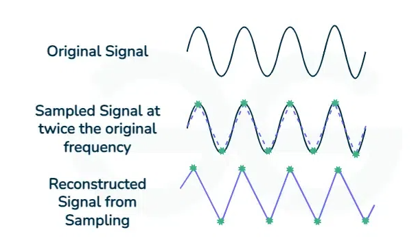

#### Hampel filter

Removes outliers

Statistical method used to detect and remove outliers in time series data or signals. It uses a moving sliding window, calculates the local median and *Median Absolute Deviation* (MAD), and replaces points that fall outside a set threshold with the median.

`How the Window Works`

- Center Point: The code looks at the current data point in the middle of the window.

- Neighbors: It grabs k points before and k points after the center point.

- Total Size: The window length equals 2k + 1 total samples.

- Sliding Action: The window moves one step forward along the dataset until it checks every point.

#### Notch filter

A notch filter is a type of **band-stop filter** with a very narrow stopband and *high* **Q factor**. 

It blocks or heavily attenuates a single specific frequency or a tiny range of frequencies, while letting all other frequencies pass through completely unchanged.

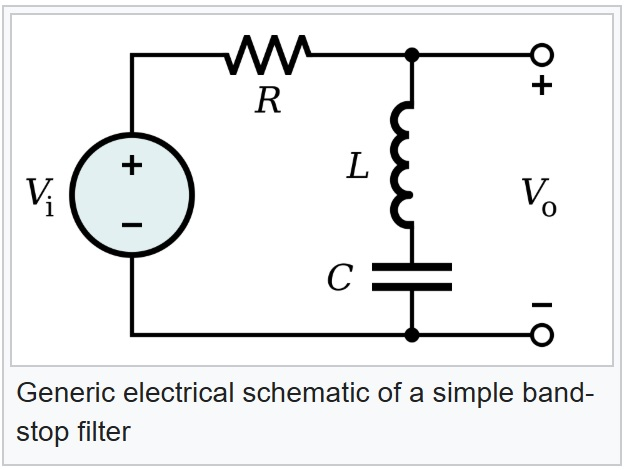

Bandstop filter is a lowpass + highpass

low  pass -> RC
high pass -> CR

notch filter ->	apply hampel filter

Q (quality factor)
BW (bandwidth)
f (Operating frequency)

BW = f / Q

Higher Q → narrower notch
Lower Q → wider notch

####  Butterworth bandpass filter

third-order -> amount of poles (capacitors)

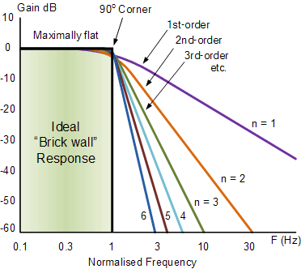

#### Savitzky-Golay filtering

a digital smoothing and filtering method that fits a low-degree polynomial to a sliding window of data points using linear least squares. It removes high-frequency noise from a signal while better preserving peak heights, widths, and high-frequency details compared to standard moving average filters.

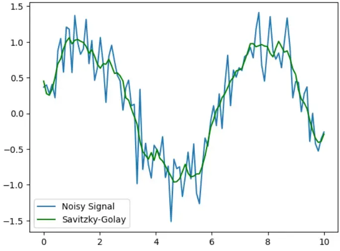

### Test processing pipeline

After successfully setting up a processing pipeline, an next step is to test the pipeline with a synthetically generated CSI data, where i know what is expected and see what the pipeline produce.

Ideally our goals should be:

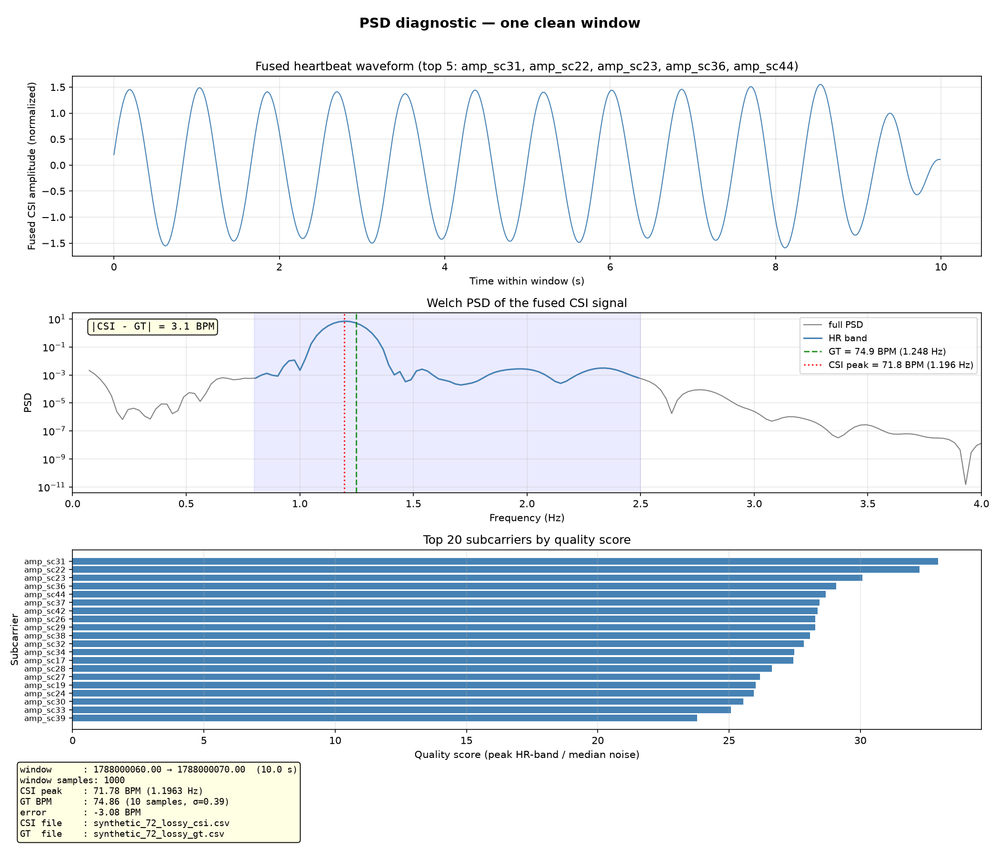

THe image above is an example output where we can see the detected heart rate and ground truth data are within a 3 BPM error. We can also see a clear bump near the HR and a very good SNR.