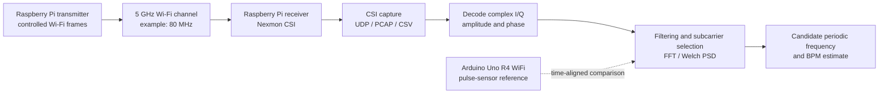

# WiPulse

## Contactless heart-rate sensing with Wi-Fi Channel State Information

WiPulse is an engineering research prototype that investigates whether small,
periodic body movement associated with a heartbeat can be detected from changes
in Wi-Fi Channel State Information (CSI), without attaching the sensing device
to the person. The repository contains the capture software, CSI decoder,
signal-processing experiments, and setup notes used to build and evaluate the
prototype.

> **Research prototype only.** WiPulse is not a medical device and does not
> provide clinically validated heart-rate measurements. Results depend on the
> recording conditions and must be checked against an independent reference.

## Project at a glance

Wi-Fi signals reflect and scatter as they travel between devices. Movement in
the environment changes the measured radio channel. CSI records the complex
response—amplitude and phase—of multiple Wi-Fi subcarriers, allowing those
changes to be examined over time. WiPulse captures CSI, processes it to find
periodic components, and compares candidate heart-rate estimates with
independently recorded pulse readings.

The project began with a broader concept involving ESP32 hardware, machine
learning, and a mobile interface. The completed proof of concept instead uses
two Raspberry Pi 5 devices and Nexmon CSI on the receiver. Its validated work
focuses on acquisition, signal processing, and comparison with reference data;
an LSTM model and mobile application are not part of the completed system.

### Project goals

- Build a CSI sensing chain from accessible, reusable Wi-Fi hardware.
- Capture and validate timestamped CSI data at a rate suitable for analysing
  heartbeat-range periodic signals.
- Demonstrate sensitivity to known motion, then investigate human recordings
  using an independent pulse-sensor reference.
- Compare signal representations and processing methods rather than treating
  every spectral peak as a heart-rate measurement.

## System overview



In the report's representative 80 MHz capture configuration, each valid packet
contains 256 complex subcarrier values. Example optimised recordings approached
100 packets per second. The documented 5 GHz channel-36/80 MHz configuration
uses the bonded 36–48 channel group, centred at 5210 MHz; select channels and
widths only where permitted by the local regulatory domain.

### Hardware and software

| Component | Role |
|---|---|
| Raspberry Pi 5 transmitter | Sends controlled Wi-Fi frames to create repeatable traffic. |
| Raspberry Pi 5 receiver with compatible Broadcom Wi-Fi hardware | Runs Nexmon CSI to capture channel measurements. The active monitor defaults to chip `43455c0`. |
| Arduino Uno R4 WiFi and pulse sensors | Records reference heart-rate readings over serial for comparison with CSI. The project documentation describes DFRobot sensors, including an optical MAX30102 reference. |
| Python processing tools | Decode captures, inspect signal quality, filter and analyse CSI, and compare estimates with reference readings. |

## Processing workflow

The principal analysis path is:

1. Transmit known Wi-Fi frames and collect timestamped CSI packets.
2. Decode CSI payloads into complex subcarrier values; inspect packet timing,
   sequence gaps, and capture quality.
3. Derive amplitude and phase representations; clean outliers and filter
   candidate signals.
4. Rank and fuse responsive subcarriers, then estimate periodic components
   using time-domain peaks and frequency-domain FFT/Welch PSD analysis.
5. Convert candidate frequency to BPM and compare time-aligned results with
   the pulse-sensor reference.

The project evaluated amplitude, phase, common-phase removal, phase
differences, and amplitude/phase combinations. The active live monitor uses a
rolling CSI window, periodically updates estimates, and includes occupancy,
motion, signal-quality, and heart-rate stabilisation logic.
Its default live heart-rate search band is 0.7–2.5 Hz (42–150 BPM). The
processing path includes Hampel outlier filtering, a Butterworth band-pass,
drift removal, subcarrier fusion, and Welch PSD estimation. At the observed
capture rates, sampling frequency is not the main limitation; reliable
heart-rate signal quality is.

## Experimental results

The project used a controlled servo-and-foil experiment to verify that motion
can affect CSI before interpreting human recordings. It then evaluated human
CSI recordings against timestamped PPG reference readings.

| Evaluation | Reported evidence | Interpretation |
|---|---|---|
| CSI acquisition | A representative timing diagnostic measured about 97.3 packets/s; example optimised runs reported 0.43% and 0.64% packet loss. | Capture targets were achieved in those runs; performance can vary with conditions. |
| Controlled motion | A servo moving at about 0.5 Hz produced visible periodic CSI components, including a harmonic near 1.49 Hz (about 89.4 cycles/min). | Demonstrates motion sensitivity. The harmonic is **not** a human heart-rate result. |
| Human recordings | Seven recordings comprising 91,856 packets were processed. Selected results included 0.99 BPM MAE for one accepted amplitude evaluation window and a selected phase result of 6.93 BPM MAE. | Promising individual comparisons with the reference, not a population-wide accuracy claim. |
| Across-recording comparison | The report gives mean capture MAE values of approximately 28.11 BPM for amplitude and 17.82 BPM for phase across the seven recordings. | Shows substantial variability and that a strong individual result does not represent typical performance. |
| Synthetic pipeline test | Project notes report under 3 BPM error with up to 15% simulated packet loss. | Tests the analysis pipeline with known input; it is not evidence of human-sensing accuracy. |

The results support proof-of-concept feasibility, not a general-purpose monitor.
Reference readings, participant placement, motion, multipath, and subcarrier
selection can all affect an estimate. A spectral peak by itself is not evidence
that the signal came from a heartbeat. The proposal's acquisition goals were
more than 50 packets/s and less than 5% packet loss; representative runs met
those goals. Its approximately ±5 BPM heart-rate and machine-learning targets
were not established across the seven recordings, and the machine-learning
stage was not implemented. Repository troubleshooting notes also document
real captures with low quality scores and flat PSDs, so repeatable signal
quality remains an open experimental challenge. The report records that the
prototype reused existing equipment and incurred R0 in new project expenditure.

## Quick start

### Requirements

- Raspberry Pi/Linux hardware suitable for Nexmon CSI capture, with compatible
  Wi-Fi hardware and patched firmware installed.
- A configured transmitter and receiver on an appropriate channel.
- Python 3 and the packages listed in
  [`falcon/requirements.txt`](falcon/requirements.txt).
- Root/network-capture permissions for live CSI reception.

First complete the hardware, firmware, and radio configuration in the
[setup guide](setup/README.md) and the [receiver notes](notes/rx/README.md).
Those steps are necessary; installing the Python requirements alone does not
enable CSI capture.

From the repository root on the Raspberry Pi:

```bash
python3 -m venv .venv
source .venv/bin/activate
python -m pip install --upgrade pip
python -m pip install -r falcon/requirements.txt
cd falcon
sudo ../.venv/bin/python live_monitor.py \
  --iface wlan0 \
  --chip 43455c0 \
  --bw 80 \
  --capture-mode complex
```

The live monitor uses the complex capture mode by default, which preserves
amplitude and phase for later analysis. Use `c` to start or stop recording and
`q` to quit. For other chip identifiers, bandwidths, and processing options,
see the [FALCON application guide](falcon/README.md).

### Servo-frequency dashboard demo

`servo_frequency_monitor.py` provides a separate motion-frequency monitor with
a browser dashboard. To rehearse the interface without Wi-Fi hardware, run
from `falcon/`:

```bash
python servo_frequency_monitor.py \
  --simulate \
  --bw 20 \
  --simulate-hz 1.0 \
  --expected-hz 1.0
```

Synthetic input is a software demonstration, not a sensor measurement. The
dashboard binds to all network interfaces by default; keep it on a trusted
local network, do not port-forward it, and use `--web-host 127.0.0.1` to
restrict it to the Pi.

## Repository guide

| Path | Contents |
|---|---|
| [`falcon/`](falcon/) | Active capture and analysis tools: live monitor, CSI decoder, filters, heartbeat extraction, serial reference recorder, validation scripts, and servo dashboard. |
| [`setup/`](setup/) | CSI setup notes and Wi-Fi transmitter scripts. |
| [`notes/`](notes/) | Hardware, transmitter/receiver, extraction, channel, filtering, frequency-analysis, and [reorganized project background](notes/project-notes.md). |
| [`img/`](img/) | Project diagrams, hardware photographs, and signal-processing figures. |
| [`plans/`](plans/) | Development notes and known issues. |
| [`old/`](old/) | Earlier experimental implementations; not the recommended starting point. |

Useful references: [hardware](notes/hardware.md) ·
[transmitter](notes/tx/README.md) · [receiver](notes/rx/README.md) ·
[CSI extraction](notes/extraction.md) · [channels](notes/channels.md) ·
[filters](notes/filters.md) ·
[frequency-domain analysis](notes/frequency_domain_analysis.md) ·
[FFT vs. PSD](<notes/FFT VS PSD.md>) · [known issues](plans/current_problems.md).

Raw `.pcap` and `.csv` captures are ignored by Git; the repository contains the
software and documentation, not the experimental datasets.

## Responsible use and licensing

Wi-Fi sensing can reveal information about a person's presence or movement.
Collect data only with appropriate consent, protect recorded CSI and reference
measurements, and follow local radio-frequency regulations. Do not use WiPulse
for diagnosis or medical decisions.

There is currently no `LICENSE` file in this repository. Making the repository
public makes the source visible, but does not by itself grant permission to
reuse, modify, or redistribute it. Add a license if you intend to grant those
permissions.
