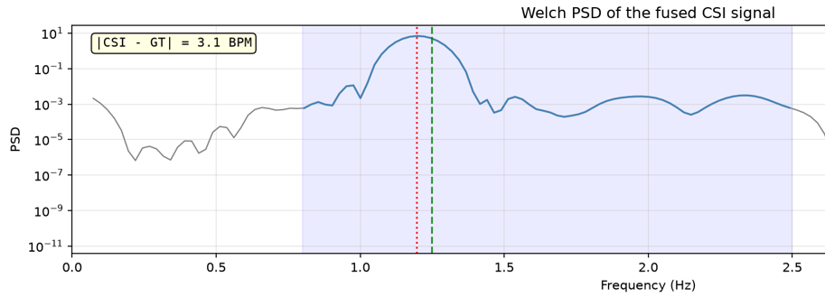

# FALCON

1. [Application](#application)
1. [Running the Live Monitor](#running-the-live-monitor)
1. [Live Monitor](#live-monitor)
1. [Serial Ground truth recorder](#serial-ground-truth-recorder)
1. [Quick Start](#quick-start)
    1. [Launch CSI capture](#launch-csi-capture)
1. [Validation](#validation)
    1. [Generate synthetic](#generate-synthetic)
    1. [Ground truth](#ground-truth)
    1. [Diagnose psd (IMPORTANT)](#diagnose-psd-important)
        1. [Usage](#usage)
    1. [Multi capture validation](#multi-capture-validation)
    1. [Multi capture validation run](#multi-capture-validation-v2)
        1. [Add files to test](#add-files-to-test)
        1. [For Old Beat Timestamp](#for-old-beat-timestamp-csvs)
1. [Key Parameters to Tune](#key-parameters-to-tune)
1. [Success Criteria](#success-criteria)
    1. [Metrics Explained](#metrics-explained)

## Application

```
falcon/
├── live_monitor.py                         # Live CSI monitor and heart-rate estimates
├── heartbeat_extraction.py                 # Offline and live heartbeat analysis
├── filters.py                              # CSI filtering utilities
├── decoder.py                              # CSI decoding
├── pi_serial_recorder.py                   # Ground-truth recording
├── servo_frequency_monitor.py              # Servo-motion frequency monitor and dashboard
├── servo_frequency_monitor_debug.py        # Capture diagnostics for the servo monitor
└── output/                     # Output directory
```

## Running the Live Monitor

 - Bare minimum

```bash
sudo python3 live_monitor.py \
    --iface wlan0 \
    --chip 43455c0 \
    --bw 80 \
    --capture-mode complex
```

 - Fine tune occupancy detection

 ```bash
sudo python live_monitor.py --iface wlan0 --chip 43455c0 --bw 80 --capture-mode complex --occupancy-diversity 0.0001 --occupancy-threshold 0.00013

sudo python live_monitor.py --iface wlan0 --chip 43455c0 --bw 80 --capture-mode complex --occupancy-diversity 0.0001 --occupancy-threshold 0.00028

# Vary --occupancy-threshold
# and  --occupancy-diversity
# Bigger stricter, lower lax
 ```
 - Maximum options

```bash
sudo python3 live_monitor.py \
    --iface wlan0 \
    --chip 43455c0 \
    --bw 80 \
    --hr-window 30 \
    --hr-update 2 \
    --hr-low 0.7 \
    --hr-high 2.5 \
    --hr-subcarriers 12 \
    --hr-percentile 20 \
    --capture-mode complex
```

 - Options

 ```bash
 # Option A: Lower HR range (for resting)
--hr-low 0.7 --hr-high 2.0

# Option B: Tighter subcarrier selection (better quality)
--hr-subcarriers 8

# Option C: Longer window (more stable)
--hr-window 35.0
```

## Live Monitor 

The live estimator below uses a 30-second rolling CSI window, recalculates approximately every 2 seconds, and estimates BPM from the dominant PSD peak in the configured heartbeat band. It also reports a confidence value based on peak prominence relative to the surrounding PSD.

The pipeline is:

complex CSI → bad-subcarrier cleaning/interpolation → amplitude → Hampel → optional notch → heartbeat bandpass → drift removal → normalization → Welch PSD → BPM

```
/live_monitor.py 
|
|-decoder.py
|
|-filters.py
|
|-heartbeat_extraction.py   # recently added for live view HR
```

## Serial Ground truth recorder

`pi_serial_recorder.py` receivers heartbeat information from two sensors managed by an Arduino Uno R4 Wifi, and send the average Heartrate to the Raspberry PI.

```bash
python pi_serial_recorder.py
```

# Quick Start

## Launch CSI capture

Quick launch CSI and ground truth capture with 

```bash
./start_wipulse_capture.sh
```

# Validation

## Diagnose psd (IMPORTANT)

Diagnose captured CSI data.

What to look out for:

1. How close the red line (CSI) and green lines (GT) are from each other. Error < 5 BPM
1. Clear bumb around red line, most signal at heart-rate vs noise around HR
1. High signal to noice ratio (qaulity score) > 20
1. CSI peak -> Heart-rate
1. Sinusoidal fused CSI amplitude (back and forth movement of chest)




## Key Parameters to Tune

|Parameter|	Current|	Range to Try|	Rationale|
|---|---|---|---|
|Low cutoff|	0.8 Hz|	0.5-1.0 Hz|	Catch lower heart rates|
|High cutoff|	2.5 Hz|	2.0-3.5 Hz|	Include harmonics|
|Filter order|	3|	2-5|	Balance sharpness vs stability|
|Peak detection threshold|	0.3 std|	0.2-0.6 std|	Adjust sensitivity|
|Min beat distance|	300ms|	250-400ms|	Physiological range|

`How to convert from frequency to Beats per minute.`

0.8 Hz => 0.8 beats per second

0.8 x 60 = 48 beats per minute

 - 0.8 Hz = 48 bpm

 - 2.5 Hz = 150 bpm


## Success Criteria

|Metric|	Target|
|---|---|
|F1-Score|	> 0.75|
|HR MAE|	< 5 BPM|
|HR Correlation|	> 0.8|
|Timing Error|	< 50 ms|

### Metrics Explained

|Metric|	Description|
|---|---|
|Precision|	% of CSI detections that are correct|
|Recall|	% of actual beats that were detected|
|F1-Score|	Harmonic mean of precision and recall|
|MAE|	Mean absolute error in beat timing|
|RMSE|	Root mean square error of heart rate|
|Correlation|	Pearson correlation of heart rates|