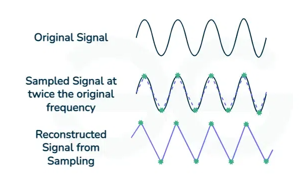
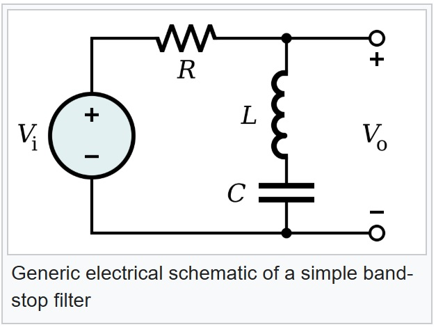
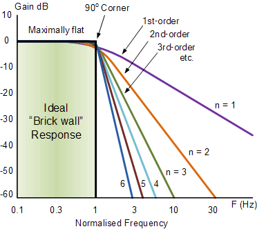
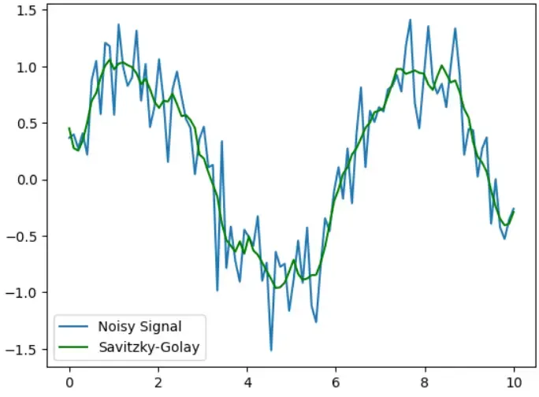

### Filters

Cardiac range is ~0.5–3.7 Hz (30–220 BPM), so you'd want butterworth_bandpass(amp, low_hz=0.8, high_hz=3.5, fs_hz=dataset.fs_est) on a per-subcarrier or PCA-combined signal — heartbeat's amplitude signature in CSI is much subtler than walking, so single-subcarrier variance analysis will likely be noisy. Common approach: bandpass each subcarrier, then pick/average the ones with the strongest SNR in that band (or PCA across subcarriers first, then bandpass the principal component).

The 100 Hz sender is plenty for Nyquist (need >~7.4 Hz for 220 BPM), so sample rate isn't the bottleneck — signal quality/placement will be.

The Nyquist Rate: This is the minimum sampling speed required to avoid distortion. For example, because human hearing tops out at about 20,000 Hz, digital audio is typically sampled at 44,100 Hz (or 44.1 kHz) to perfectly capture all audible frequencies.

The Nyquist Frequency (or Folding Frequency): This is exactly half of the sampling rate. Any frequency present in the original signal that is higher than the Nyquist frequency will "fold" over and cause distortion in the digital version. This phenomenon is known as aliasing.

#### Hampel filter

Removes outliers

Statistical method used to detect and remove outliers in time series data or signals. It uses a moving sliding window, calculates the local median and *Median Absolute Deviation* (MAD), and replaces points that fall outside a set threshold with the median.

`How the Window Works`

- Center Point: The code looks at the current data point in the middle of the window.

- Neighbors: It grabs k points before and k points after the center point.

- Total Size: The window length equals 2k + 1 total samples.

- Sliding Action: The window moves one step forward along the dataset until it checks every point.

#### Notch filter

A notch filter is a type of **band-stop filter** with a very narrow stopband and *high* **Q factor**. 

It blocks or heavily attenuates a single specific frequency or a tiny range of frequencies, while letting all other frequencies pass through completely unchanged.

Bandstop filter is a lowpass + highpass

low  pass -> RC
high pass -> CR

notch filter ->	apply hampel filter

Q (quality factor)
BW (bandwidth)
f (Operating frequency)

BW = f / Q

Higher Q → narrower notch
Lower Q → wider notch

####  Butterworth bandpass filter

third-order -> amount of poles (capacitors)

#### Savitzky-Golay filtering

a digital smoothing and filtering method that fits a low-degree polynomial to a sliding window of data points using linear least squares. It removes high-frequency noise from a signal while better preserving peak heights, widths, and high-frequency details compared to standard moving average filters.

