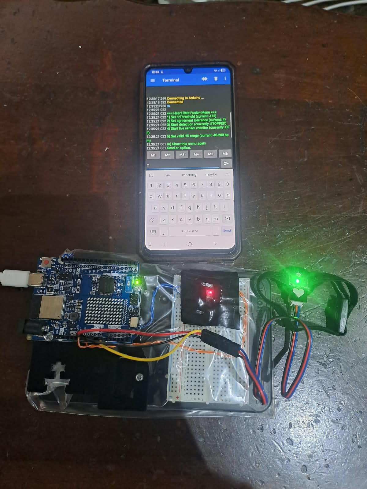
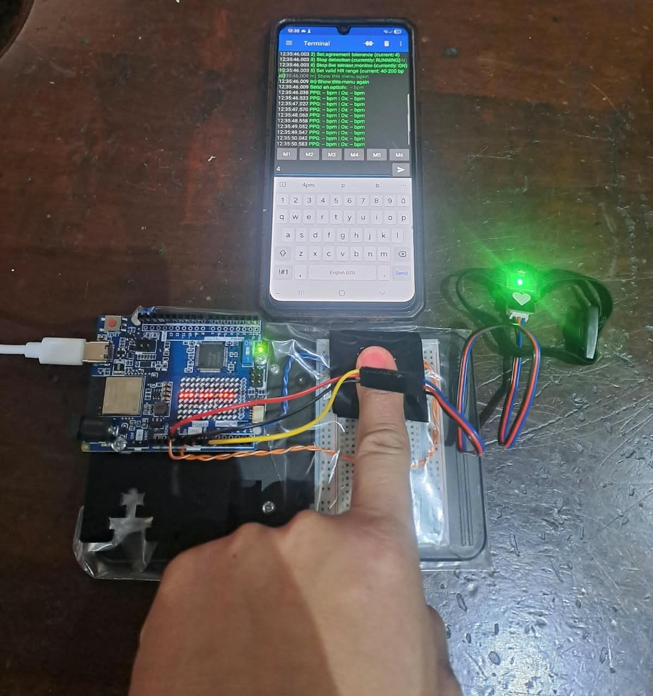
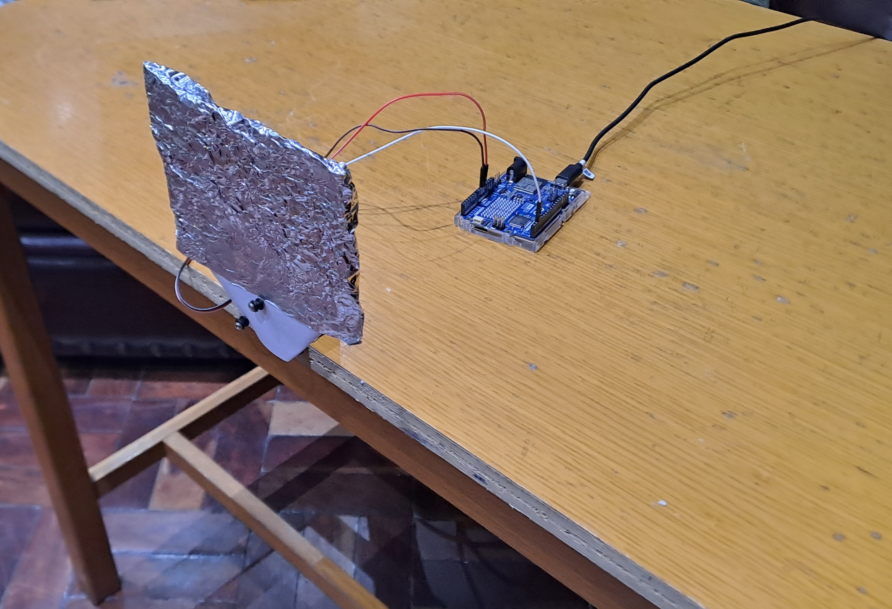
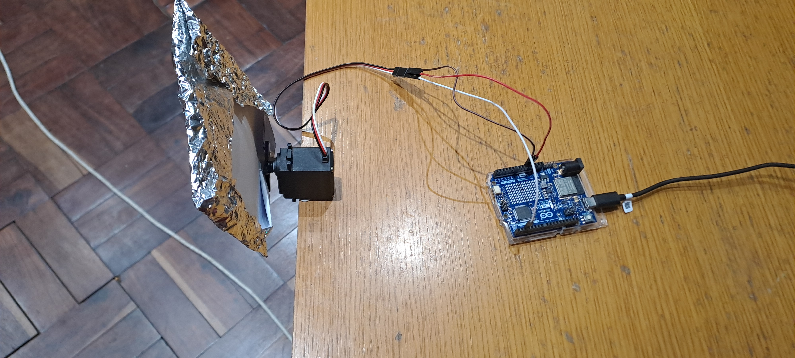
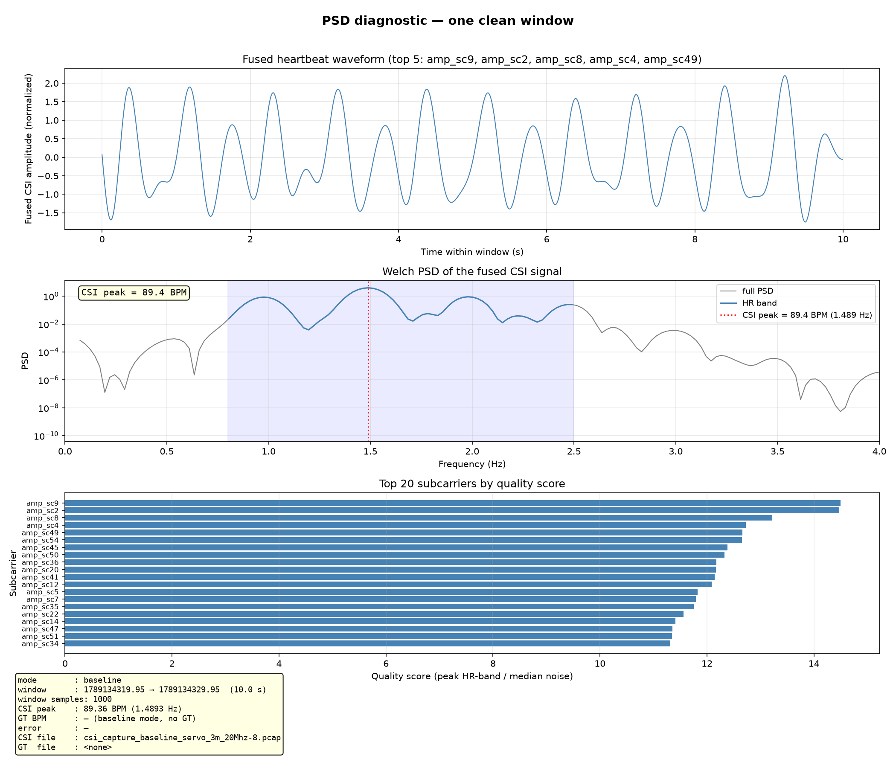
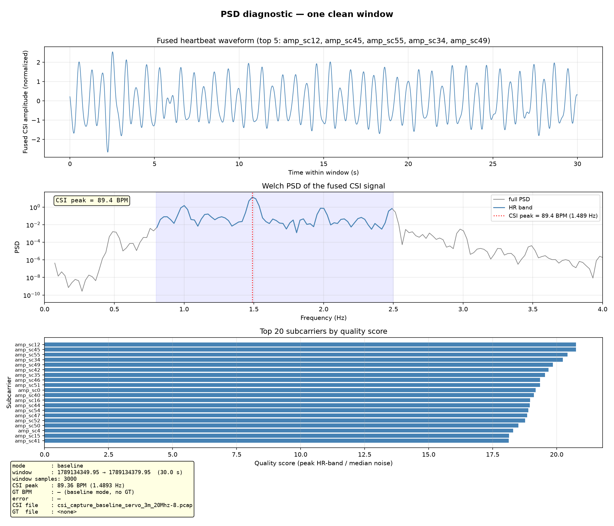

# Hardware Setup

An Arduino and two sensors was used to obtain groundtruth data




## Fermion: MAX30102 Heart Rate and Oximeter Sensor

DFRobot Heart Rate and Oximeter Sensor Breakout Board Heart Rate Sensor Breakout Board for Sensor

### BUY

https://za.rs-online.com/web/p/sensor-development-tools/2473241

### Information

https://wiki.dfrobot.com/sen0344/

### Arduido Code

```
gainHeartbearSPO2

/LIBS
|
|-DFRobot_BloodOxygen_S
|-DFRobot_RTU
```

## Gravity: Heart Rate Monitor Sensor

https://wiki.dfrobot.com/sen0203

### Arduido Code

```
heartrateAnalogMode

/LIBS
|
|-DFRobot_Heartrate
```

## Arduino Uno R4 Wifi

```
# Test both sensors with Arduino
heart_rate_fusion

# V2 including bluetooth feature
heart_rate_fusion-bluetooth_V2

# V3 including min/max
heart_rate_fusion-bluetooth_V3

# V4 miss-behaving SEN0203 sensor removed from validation
heart_rate_fusion-bluetooth_V4

# V5 Use LED Matrix to report Heartrate
heart_rate_fusion-bluetooth_V5

/LIBS
|
|-DFRobot_BloodOxygen_S
|-DFRobot_RTU
|-DFRobot_Heartrate
|-ArduinoBLE
|-HardwareBLESerial
```

### Setup

Connect Arduino Uno R4 USB port to any USB-A port on the Pi 5

 - Find the serial device name

```bash
# before and after plugging in the Arduino
ls /dev/tty* 
```

Usually something like

`/dev/ttyACM0` or `/dev/ttyACM1`

Give your user permission to use it

```bash
sudo usermod -aG dialout $USER
# log out and back in (or reboot) for it to take effect. 
```
Sanity-check

```bash
# install screen if needed
sudo apt install screen 

# Sanity-check the raw link
screen /dev/ttyACM0 115200

# Ctrl-A then K to exit screen.
```

### Install pyserial and run the reader script

```bash
pip3 install pyserial

python3 pi_serial_recorder.py
# If the device wasn't `/dev/ttyACM0`, edit the `PORT` variable at the top of the script first.
```

## Arduino with Servo

Setup an Arduino with a servo motor, connect a piece of foil to the servo.

See if the CSI capture the frequency of the servo.




Code in setup/arduino/testing_60hz

### What Each Parameter Change Should Do

#### Speed changes (delay between steps)

If you keep amplitude at 45° but change the delay:

|Delay (s) |	Fundamental (Hz)	| 3rd harmonic (Hz)	|Predicted BPM peak|
|---|---|---|---|
|0.5|	1.0|	3.0|	outside band, might see 2.0 Hz|
|0.75|	0.667|	2.0|	120 BPM|
|1.0| (current)	0.5|	1.5|	90 BPM|
|1.25|	0.4|	1.2|	72 BPM|
|1.5|	0.333|	1.0|	60 BPM|
|2.0|	0.25|	0.75|	45 BPM (edge of band)|

**Recommended tests**: delay = 0.75 s (expect 120 BPM), delay = 1.25 s (expect 72 BPM), delay = 1.5 s (expect 60 BPM). These all land inside your 0.8-2.5 Hz band on a clean harmonic.

#### Amplitude changes (angle)

Reducing the angle from 45° to 10° won't change the frequency of the motion — it will only change the **magnitude** of the reflected signal. So the peak stays at 1.5 Hz (90 BPM), but the **quality score should drop**.

This is a great test for **sensitivity**, which directly relates to the human-chest question:

|Angle|	Expected quality score|	Interpretation|
|---|---|---|
|45°|	~15-20 (current)|	Strong reflection|
|20°|	~8-12|	Moderate|
|10°|	~4-8|	Weak|
|**5°**|	**~2-4**|	**Borderline detection**|
|2°|	< 2|	Below noise|

**The angle at which the quality score drops below ~3 is roughly the minimum detectable motion**. Compare that to what a chest produces (roughly equivalent to a foil rotation of 0.1-0.5°) and you'll know whether a human will work.

### CSI capture results

Note the 3 distint *bumps* at each expected **Harmonic frequency**.

0.5 Hz = 30 BPM
1 Hz   = 60 BPM
1.5 Hz = 90 BPM (dominant frequency)
2 Hz   = 120 BPM

#### 10 Second window



#### 30 Second window

