# WiPulse Project Notes

> This document reorganizes the project background and technical learning notes
> that previously lived in the repository's root README. For the current
> project summary and quick start, see the [repository landing page](../README.md).

## Contents

- [Project background](#project-background)
- [Objectives](#objectives)
- [System design and development](#system-design-and-development)
- [Wi-Fi and CSI fundamentals](#wi-fi-and-csi-fundamentals)
- [Signal-processing notes](#signal-processing-notes)
- [Validation approach](#validation-approach)
- [Related documentation](#related-documentation)

## Project background

WiPulse explores whether changes in Wi-Fi Channel State Information (CSI) can
be used to observe small periodic movements associated with a heartbeat. CSI
describes the complex channel response across Wi-Fi subcarriers, including
amplitude and phase. Changes in the environment can alter that response, so a
sequence of CSI samples can be analysed for periodic components.

The original motivation was to investigate a less intrusive alternative for
settings where contact-based vital-sign sensors may be inconvenient. This is
research into sensing feasibility, not a claim that Wi-Fi measurements can
replace clinical sensors or provide medical monitoring.

The original project concept proposed inexpensive IoT hardware, contactless
vital-sign extraction, machine learning, and a mobile-facing display. Those
were initial goals, not all completed features. The implemented research
prototype uses Raspberry Pi 5 transmitter/receiver hardware, Nexmon CSI on the
receiver, Python signal-processing tools, and a separate pulse-sensor reference.
The current implementation and its measured results are summarized in the
[landing page](../README.md).

This is an experimental sensing project, not a medical device. A frequency
peak alone does not establish that the source is a heartbeat; measurements
must be interpreted in context and compared with an independent reference.

## Objectives

The project objectives were to:

1. Use accessible, commercially available computing and Wi-Fi hardware.
2. Configure radio firmware and software to send frames and capture CSI.
3. Record radio measurements, including CSI and, where available, RSSI and
   packet metadata.
4. Transform complex CSI into useful signal representations.
5. Process and evaluate periodic components against known movement and
   reference heart-rate data.
6. Present, record, and inspect results in a form that supports validation.

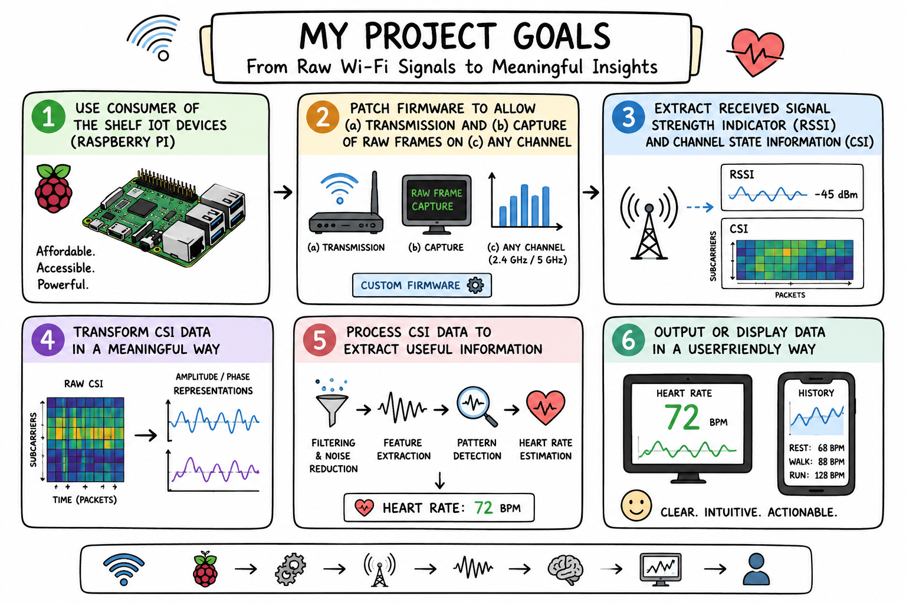

## System design and development

The early architecture diagrams and progress images document the evolution of
the system. They are historical project material; consult the active
[setup guide](../setup/README.md) and [FALCON application guide](../falcon/README.md)
for current commands and software.

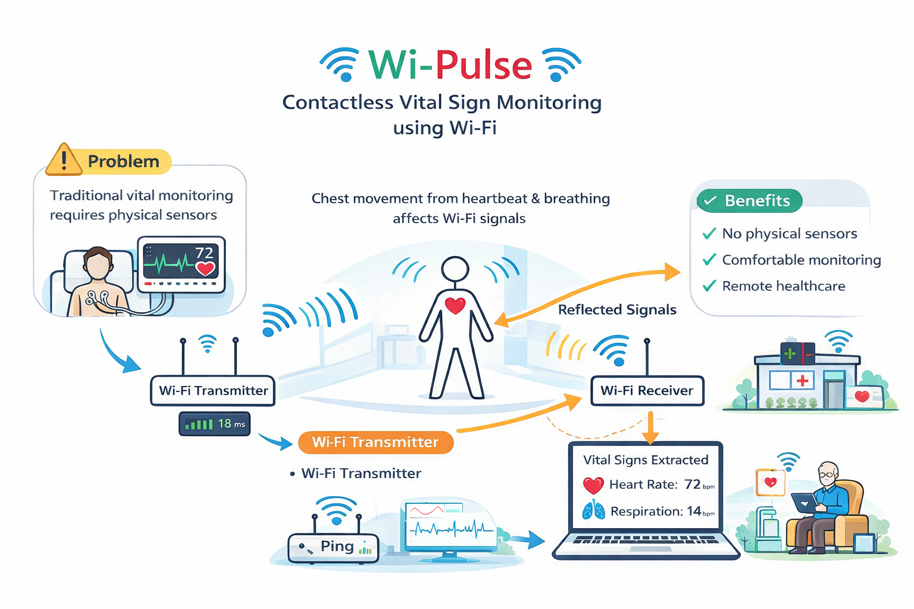

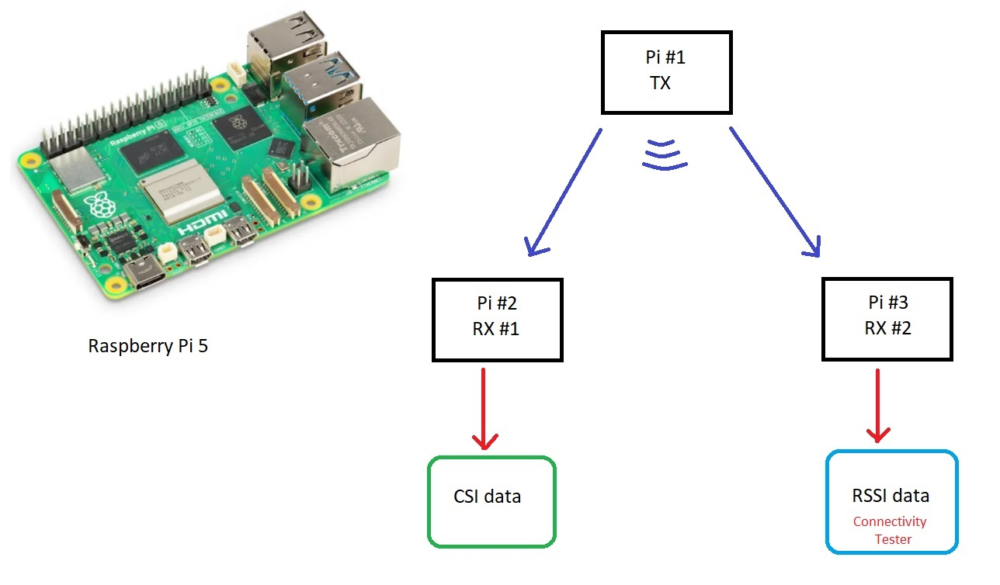

### Operating-system and radio layers

The project work spans application software, drivers, firmware, and the radio
hardware. The application creates or processes data; the driver and firmware
configure the wireless device; the radio transmits or receives frames. CSI
capture depends on support across these layers, which is why compatible
hardware and patched receiver firmware are prerequisites.

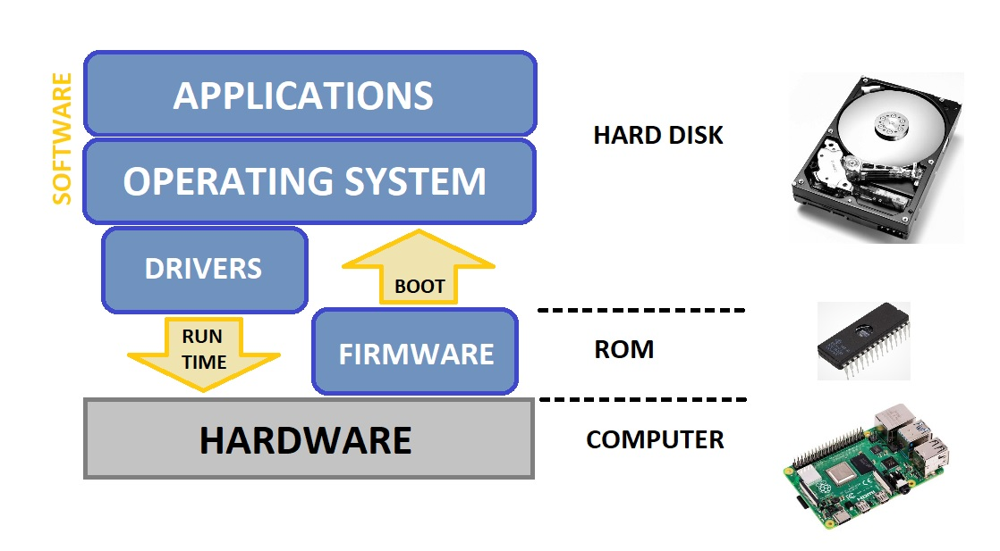

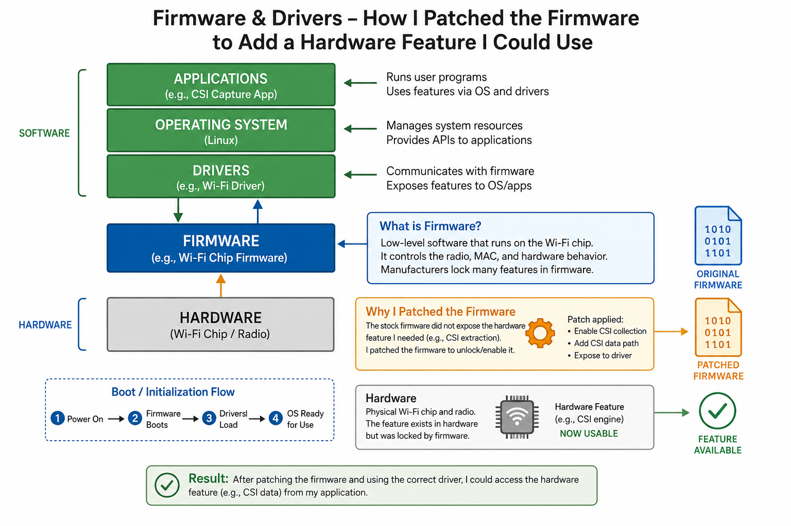

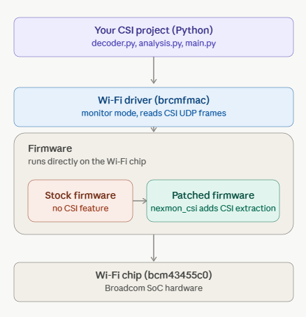

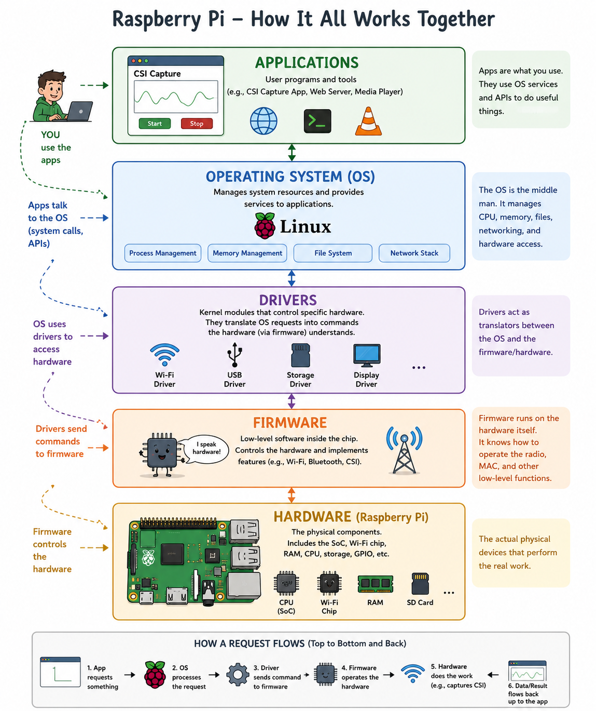

### Frame workflow

The transmitter sends controlled Wi-Fi frames to create repeatable channel
measurements. The receiver captures CSI associated with received frames, and
the software decodes the resulting packet payloads for analysis.

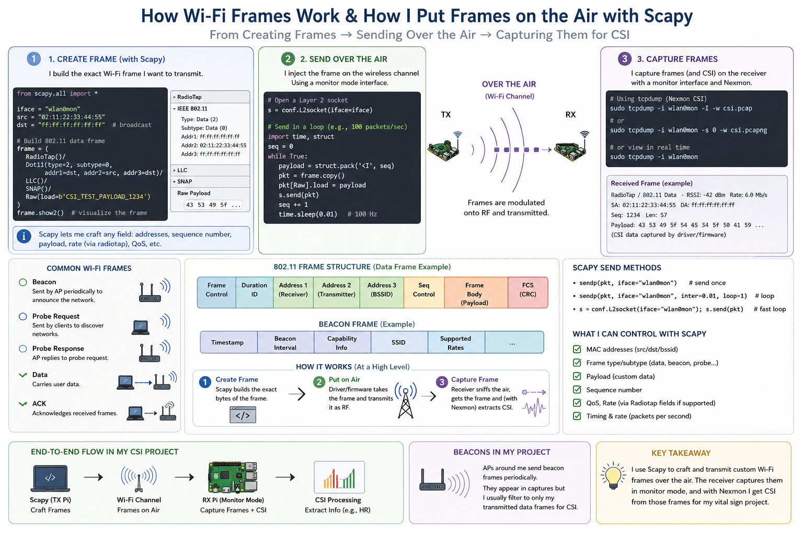

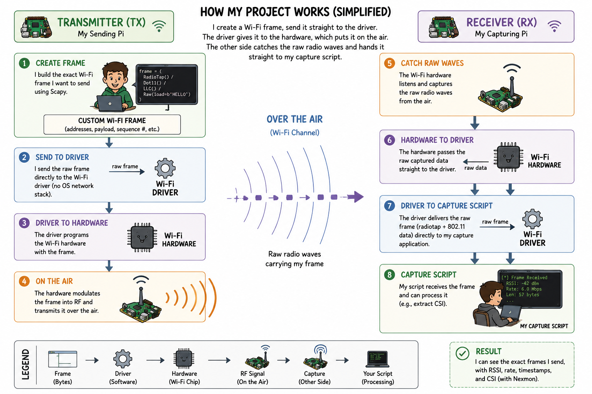

## Wi-Fi and CSI fundamentals

### Channel bandwidth and subcarriers

An 80 MHz VHT80 configuration combines four adjacent 20 MHz channel segments.
For the channel-36 group, the segment center frequencies are:

| 20 MHz segment | Center frequency |
|---|---:|
| 36 | 5180 MHz |
| 40 | 5200 MHz |
| 44 | 5220 MHz |
| 48 | 5240 MHz |

The 80 MHz channel block is centred at 5210 MHz. The receiver's configured
bandwidth determines the number of CSI values exposed by the decoder:

| Configured bandwidth | CSI vector length (`NFFT`) |
|---:|---:|
| 20 MHz | 64 |
| 40 MHz | 128 |
| 80 MHz | 256 |

These are the decoder's configured vector lengths, not a claim that every
subcarrier is an active data subcarrier. Actual channels and widths must be
selected according to hardware support and local radio-frequency regulations.
The older notes recorded the following possible South Africa channel values.
They are retained here for historical context only: the entries mix channel
numbers and width labels and must not be used as a regulatory or configuration
table without verification.

| Historical label | Values recorded in the older notes |
|---|---|
| 80 MHz | 36, 44, 100, 108, 116, 124 |
| 20 MHz | 40, 48, 104, 112, 120, 128, 136 |

Check the applicable local rules, hardware support, and the project's
[channel notes](channels.md) before configuring a radio.

### Channel-width terminology

- **HT20** uses one 20 MHz channel.
- **HT40+** and **HT40-** describe 40 MHz operation with the secondary channel
  above or below the primary channel, respectively.
- **VHT80** describes 802.11ac operation with an 80 MHz channel width.
- A channel-width label such as `80 MHz` describes bandwidth; it is not itself
  a primary channel number.

For the actual channel setup procedure, see the [setup guide](../setup/README.md).

## Signal-processing notes

### Frequency range and sampling

Frequency in hertz is cycles per second. Convert a candidate frequency to
cycles per minute (or BPM) by multiplying by 60; for example, 1 Hz corresponds
to 60 cycles per minute. In this application, a nominal heart-rate search band
of 0.8–3.5 Hz corresponds to 48–210 cycles per minute. The active live monitor
uses its own configurable range; see the [application guide](../falcon/README.md).

The Nyquist frequency is half the sampling frequency. A signal must be sampled
at more than twice its highest frequency of interest to avoid aliasing. At
220 BPM (about 3.67 Hz), the theoretical minimum is greater than 7.34 samples
per second. The project's nominal 100 Hz sender rate is above this sampling
requirement, but a sufficiently high rate does not guarantee a clean or
detectable heartbeat signal: placement, multipath, motion, noise, and capture
quality remain important.

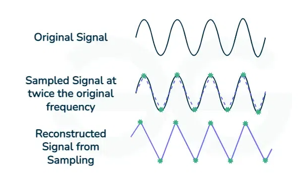

### Filtering and signal conditioning

The following methods were considered or used during project development.
Their inclusion here describes the investigation; it does not mean every
method is enabled in the live pipeline.

| Method | Purpose |
|---|---|
| Hampel filter | Detects local outliers using a moving-window median and median absolute deviation (MAD); an outlier may be replaced by the local median. A window of radius `k` contains `2k + 1` samples. |
| Notch filter | Attenuates a narrow frequency band, often to suppress a known interference frequency. Its quality factor is `Q = f₀ / BW`, where `f₀` is the notch frequency and `BW` its bandwidth. A notch filter is distinct from a Hampel outlier filter. |
| Butterworth band-pass | Retains a selected frequency band while attenuating frequencies outside it. Filter order affects the response slope and implementation characteristics. |
| Savitzky–Golay filter | Smooths data by fitting a low-degree polynomial over a sliding window; can preserve peak shape better than a simple moving average. |
| Subcarrier selection or fusion | Combines responsive CSI subcarriers rather than relying on a single potentially noisy subcarrier. |

The candidate heartbeat component is small compared with other environmental
movement. Analysis may therefore band-pass subcarriers individually, rank
them by signal quality, and combine a selected set; principal-component
analysis was also considered as a way to combine cross-subcarrier information.
See the project's [filtering notes](filters.md) for additional background.

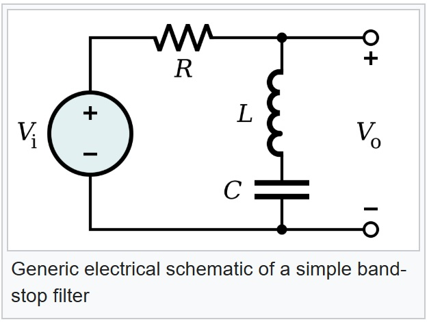

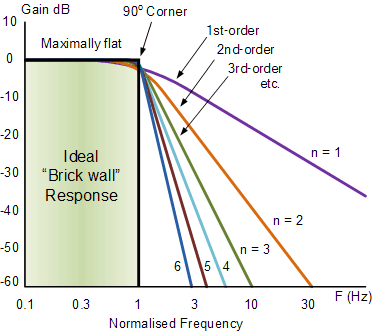

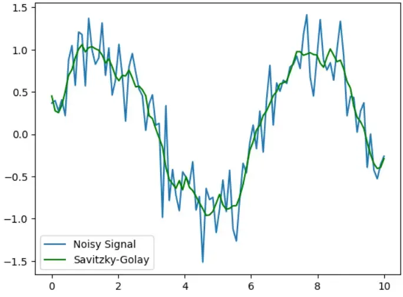

### Harmonics

Harmonics are integer multiples of a fundamental frequency. Periodic movement
or a non-sinusoidal signal can therefore produce peaks at both the fundamental
and higher multiples. A strong peak in a candidate heart-rate band may be a
harmonic of breathing, motion, or a controlled test stimulus rather than a
heartbeat. The servo experiment is useful for demonstrating this distinction:
it validates motion sensitivity, not physiological heart-rate accuracy.

## Validation approach

Synthetic data with a known periodic component is useful for checking the
analysis code because the expected frequency is known in advance. Project
notes include a synthetic example with an estimated value within 3 BPM of its
ground truth, including a simulated packet-loss case. This validates the
processing path under that test; it is not evidence of equivalent accuracy on
human recordings.

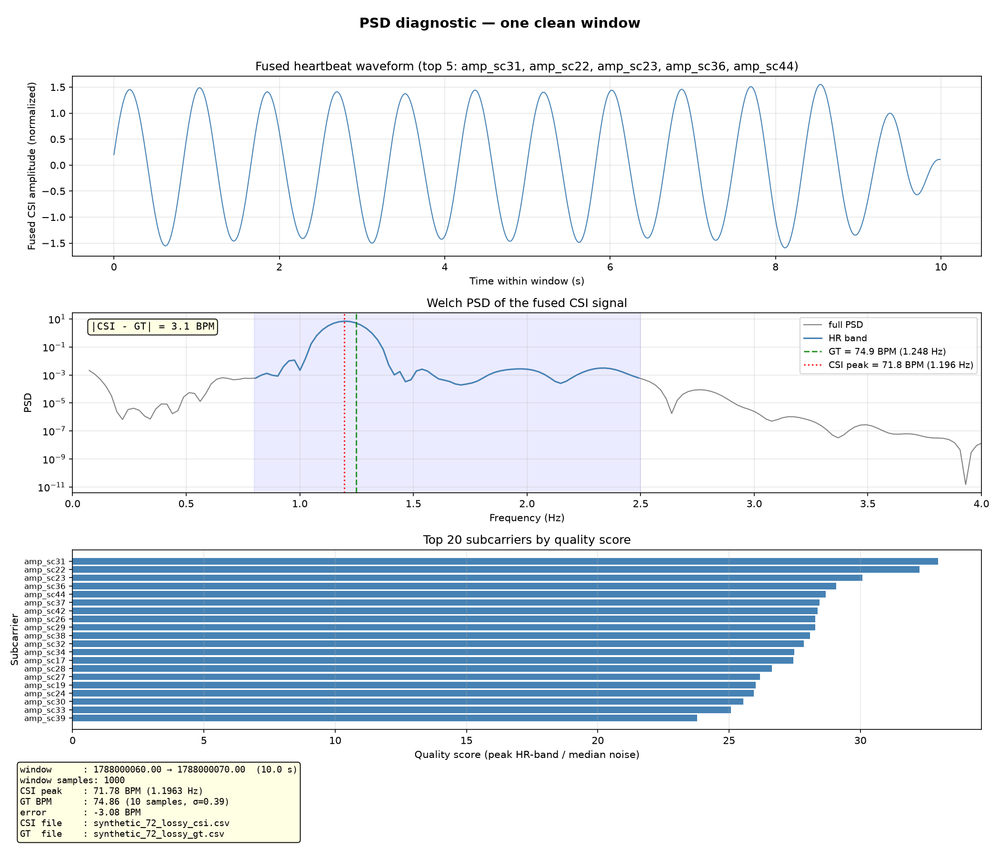

Validation should distinguish at least three different questions:

1. **Acquisition:** Are CSI packets valid, correctly decoded, and timestamped
   at a suitable rate?
2. **Motion sensitivity:** Does a known physical stimulus create a measurable
   periodic CSI component?
3. **Physiological agreement:** Does a human-recording estimate agree with an
   independent, time-aligned pulse reference across multiple recordings?

Passing one stage does not by itself establish the next. Refer to the
[project results](../README.md#experimental-results) and
[known experimental issues](../plans/current_problems.md) for recorded
performance and ongoing limitations.

## Related documentation

- [Hardware and reference sensors](hardware.md)
- [Transmitter notes](tx/README.md)
- [Receiver notes](rx/README.md)
- [CSI extraction and setup](extraction.md)
- [Channel configuration](channels.md)
- [Filtering notes](filters.md)
- [Frequency-domain analysis](frequency_domain_analysis.md)
- [FFT versus PSD](<FFT VS PSD.md>)
